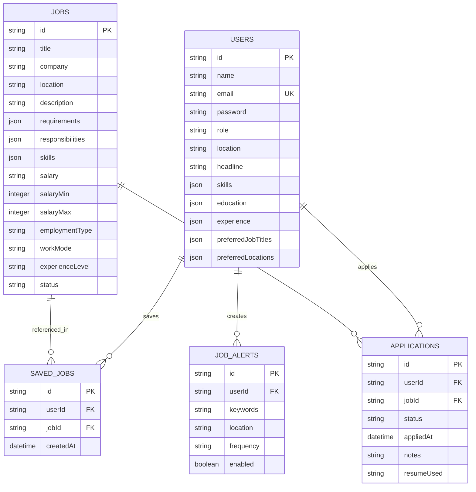

# 🚀 Synapse AI & Tech Job Portal — Phase 1 Backend Foundation

A modern full-stack job platform built with **React**, **TypeScript**, **Vite**, **Node.js**, **Express**, and **SQLite**.

---

## 🏗️ Architecture Overview

The application follows a clean layered full-stack architecture:

- **Frontend (`/src`)**: Single Page Application built using React 18, TypeScript, React Router 6, and Vite.
- **Backend (`/server`)**: REST API server built with Node.js, Express, and TypeScript (`tsx`).
- **Database (`/data/database.sqlite`)**: Relational SQLite database with foreign key constraints, JSON array serialization, and indexing.
- **Authentication**: JWT (JSON Web Token) bearer authentication with bcrypt password hashing.

---

## 🗄️ Database Schema & Relationships



---

## 🔌 API Endpoints Summary

### 🔑 Authentication (`/api/auth`)
- `POST /api/auth/register` — Register new candidate or recruiter account
- `POST /api/auth/login` — Authenticate and receive JWT token
- `POST /api/auth/logout` — End session
- `GET /api/auth/me` — Retrieve authenticated user state

### 👤 User & Profile (`/api/users`)
- `GET /api/users/profile` — Get full user profile
- `PUT /api/users/profile` — Update headline, bio, experience, skills, education, resume
- `PUT /api/users/preferences` — Update job titles, locations, and salary targets

### 💼 Jobs (`/api/jobs`)
- `GET /api/jobs` — Retrieve active jobs with keyword, location, type, work mode, level filters & pagination
- `GET /api/jobs/:id` — Get detailed job specification
- `POST /api/jobs` — Create new job listing (Admin required)
- `PUT /api/jobs/:id` — Update job listing (Admin required)
- `DELETE /api/jobs/:id` — Delete job listing (Admin required)

### 📌 Saved Jobs (`/api/saved-jobs`)
- `GET /api/saved-jobs` — List user's saved jobs
- `POST /api/saved-jobs` — Save a job bookmark
- `DELETE /api/saved-jobs/:jobId` — Remove job bookmark

### 📝 Applications (`/api/applications`)
- `GET /api/applications` — List submitted applications with job metadata
- `POST /api/applications` — Submit job application
- `PUT /api/applications/:id/status` — Update application tracking status

### 🔔 Job Alerts (`/api/alerts`)
- `GET /api/alerts` — Fetch user's job search alerts
- `POST /api/alerts` — Create alert for keywords, location, frequency
- `PUT /api/alerts/:id` — Update/toggle job alert
- `DELETE /api/alerts/:id` — Delete job alert

---

## ⚙️ Environment Variables (`.env`)

```env
PORT=5000
NODE_ENV=development
JWT_SECRET=synapse_job_portal_super_secret_jwt_key_2026!
DATABASE_PATH=./data/database.sqlite
CORS_ORIGIN=http://localhost:5173
```

---

## 🚀 How to Run Locally

### 1. Seed Development Database
```bash
npm run seed
```
Creates sample demo users:
- **Admin**: `admin@synapse.io` / `password123`
- **Candidate**: `alex.morgan@example.com` / `password123`
- Seeded with 12 realistic job roles across Software Engineering, Data Science, AI/ML, UI/UX, DevOps, QA, and Cloud Architecture.

### 2. Start Backend Server Only
```bash
npm run server
```
Runs Express API server at `http://localhost:5000`.

### 3. Start Frontend & Backend Together
```bash
npm run dev:all
```
Runs Vite dev server (`http://localhost:5173`) and Express backend (`http://localhost:5000`) concurrently.

---

## 🎯 Phase 1 Completion Summary

All tasks for **Phase 1 — Backend Foundation** have been implemented and validated:
- ✅ Analyzed existing React + Vite + TypeScript frontend structure and preserved all UI design & routes.
- ✅ Created Node.js + Express + TypeScript backend server.
- ✅ Created SQLite database initialization module with relational tables & foreign key cascade protection.
- ✅ Implemented JWT authentication & authorization middleware.
- ✅ Created Controllers & Routes for Auth, Users, Jobs, Saved Jobs, Applications, and Job Alerts.
- ✅ Implemented input validation and centralized error handling.
- ✅ Built seed script (`npm run seed`) with 12+ realistic tech jobs and sample candidate/admin accounts.
- ✅ Created frontend API client service (`src/services/api.ts`) and configured Vite dev proxy (`/api`).


## 🔐 Authentication — OTP / SMTP Email Sign-In (no passwords)

The marketplace uses **passwordless email OTP sign-in** as the only auth flow:
- Enter your email in the sign-in modal.
- The server emails a 6-digit verification code (via SMTP).
- Enter the code to finish sign-in (accounts are created automatically on first sign-in).
- **No password login/register UI exists.** Legacy `/auth/login` & `/auth/register` REST routes remain on the server for backward compatibility and tests only.
- **SMTP configuration:** set `SMTP_HOST/SMTP_PORT/SMTP_SECURE/SMTP_USER/SMTP_PASSWORD/SMTP_FROM` in `.env` to deliver real emails.
- **Dev fallback:** if SMTP is not configured and `NODE_ENV != production`, the code is printed to the server console (never the API) so the flow is testable locally. In production, OTP is refused until SMTP is configured.